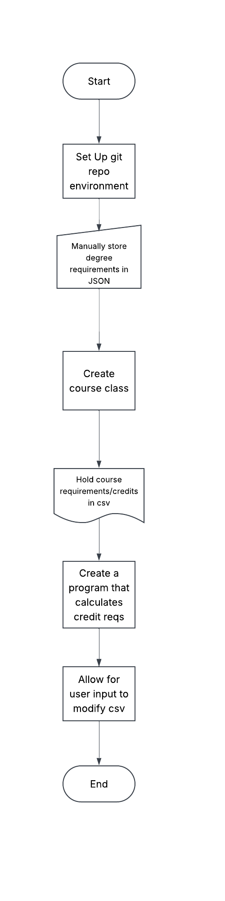

# Degree-Progression-Tracker

Tracks progression towards major through classes and credits.

## The Problem

Purdue Smart Plan doesn't include Integrated Science and Business yet so I can't visualize my classes through that. Therefore, I want a way to see and update my progression towards my degrees.

## How It Works

A clear, interactive list of classes that I have to take for both my majors, disregarding overlaps. Shows total credits, average credits needed for semester, and marks classes that I've already taken or completed through outside credit.



## Tech Stack

- **Language:** Java
- **Libraries:** HttpClient, Jackson
- **External tools:** Boiler.tools

## Setup

Step-by-step: how does someone who just cloned your repo get it
running?

```bash
git clone https://github.com/you/your-project
cd your-project
./install.sh   # or whatever
```

## Usage

How to actually run the thing, with examples.

```bash
./backup.sh ~/Documents
```

## Roadmap

- Add in the 2nd major requirements
- Get rid of duplicate classes from the 2 majors
- Use the API to show prerequisites for each required class


## Author

Lexi Spetter - https://github.com/lexispett26
