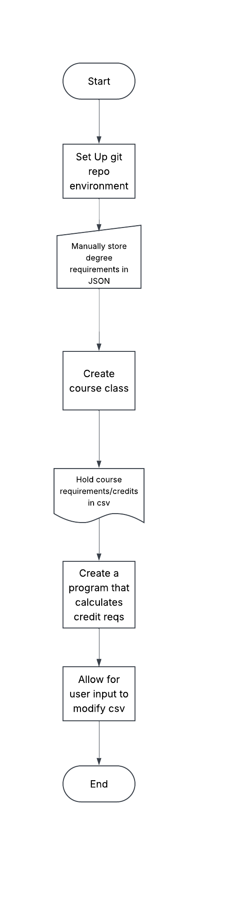

# Degree-Progression-Tracker

Personalized tracker that tracks progression towards majors through classes and credits. Focuses on Data Science and Integrated Science and Business - Applied Statistics double major.

## The Problem

Purdue Smart Plan doesn't include Integrated Science and Business yet so I can't visualize my classes through that. Therefore, I want a way to see and update my progression towards my degrees. It also allows me to choose between selectives and see credits still needed.

## How It Works

It takes data directly from myPurduePlan that I personalized into docs/my_plan.json. It doesn't include classes that I've taken through outside credit or honors credits. Then, Course.java stores the course options and requirements to allow for parsing from the JSON. Main.java runs a local HTTP server that calculates credits and displays the class list. Currently, it doesn'tsave changes when the server is restarted.

NOTE: system diagram represents original plan and some small adjustments have been made.



## Tech Stack

- **Language:** Java, HTML, JavaScript, CSS
- **Libraries:** HttpServer, Gson
- **External tools:** https://github.com/upuddu/purdue-plan

## Setup

Step-by-step: 

**Requirements** Git, JDK 17 or later, Gson library, IntelliJ

1.

```bash
git clone --branch feature/degree-tracker-updates https://github.com/lexispett26/Degree-Progression-Tracker.git
cd Degree-Progression-Tracker
```
2. Open cloned Degree-Progression-Tracker folder in IntelliJ
3. Add Gson through IntelliJ
  File -> Project Structure -> Libraries -> + -> From Maven -> com.google.code.gson:gson:2.11.0
  Add the library to the project module

## Usage

Run src/Main.java from IntelliJ
In browser, visit http://localhost:8080 (the link should show up in IntelliJ terminal)

Example Usage:
1. Scroll to Statistics Selective under ISB Requirements
2. Choose Stat 42000 for the first dropdown and STAT 47201 for the second.
3. Check 'Completed' checkbox besinde STAT 42000
4. Watch the credit counters change for total, average, and ISB credits throughout these selections.

## Roadmap

For the Future:

- Get rid of duplicate classes from the 2 majors
- Use the API to show prerequisites for each required class


## Author

Lexi Spetter - https://github.com/lexispett26
